# Results tables

Every result in this repository as tables, **generated from the committed data** by `python3 benchmark/results_tables.py`. Each table is an image (`tables/<name>.svg`, with a 2x `.png` beside it for slides and papers) and the same table as text under *as text*. Do not edit by hand: change the data or the script and regenerate. Interpretation is in [`RESULTS.md`](RESULTS.md); which experiments exist and where their data lives is in [`../docs/experiments.md`](../docs/experiments.md).

**Names.** CoPR is the paper's name for the proposed engine; run names call it `ae` (S9). `lg` is little-gemma (S3), `ngram-n3m3` is llama.cpp's n-gram drafting at width 4 (S10), an empty row name is plain llama.cpp (S1). Power is board DC draw (INA3221 on the Jetson, PMIC on the Pi), not wall power.

**Contents.** 1 · the manuscript's tables — 2 · reply identity between engines — 3 · accuracy — 4 · every Jetson run — 5 · Pi and iPhone runs — 6 · tinyGSM8k — 7 · own suite — 8 · data vs manuscript

## 1. The manuscript's tables, from the data

Rebuilt from `findings/runs/jetson/` by the functions `paper_tables.py` checks against the paper (203 values match), in the paper's layout. Table VII (the replay) follows once its token cache is filled.

### Table I — Baseline anatomy, E2B, Jetson at 15 W

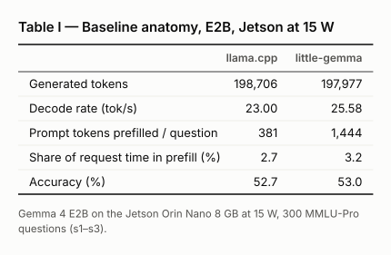

<details><summary>as text</summary>

|  | llama.cpp | little-gemma |
|---|---:|---:|
| Generated tokens | 198,706 | 197,977 |
| Decode rate (tok/s) | 23.00 | 25.58 |
| Prompt tokens prefilled / question | 381 | 1,444 |
| Share of request time in prefill (%) | 2.7 | 3.2 |
| Accuracy (%) | 52.7 | 53.0 |

Gemma 4 E2B on the Jetson Orin Nano 8 GB at 15 W, 300 MMLU-Pro questions (s1–s3).

</details>

### Table III — Engines on the Jetson Orin Nano 8 GB at 15 W, MMLU-Pro, n=300 per cell

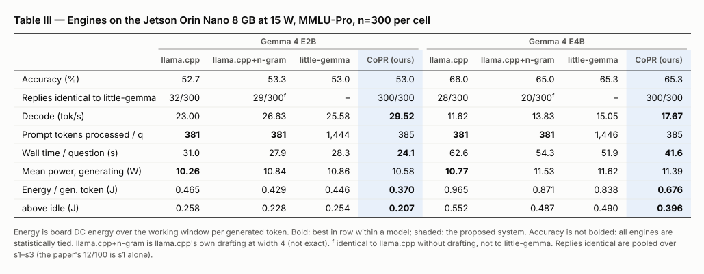

<details><summary>as text</summary>

|  | Gemma 4 E2B llama.cpp | Gemma 4 E2B llama.cpp+n-gram | Gemma 4 E2B little-gemma | Gemma 4 E2B CoPR (ours) | Gemma 4 E4B llama.cpp | Gemma 4 E4B llama.cpp+n-gram | Gemma 4 E4B little-gemma | Gemma 4 E4B CoPR (ours) |
|---|---:|---:|---:|---:|---:|---:|---:|---:|
| Accuracy (%) | 52.7 | 53.3 | 53.0 | 53.0 | 66.0 | 65.0 | 65.3 | 65.3 |
| Replies identical to little-gemma | 32/300 | 29/300ᶠ | – | 300/300 | 28/300 | 20/300ᶠ | – | 300/300 |
| Decode (tok/s) | 23.00 | 26.63 | 25.58 | **29.52** | 11.62 | 13.83 | 15.05 | **17.67** |
| Prompt tokens processed / q | **381** | **381** | 1,444 | 385 | **381** | **381** | 1,446 | 385 |
| Wall time / question (s) | 31.0 | 27.9 | 28.3 | **24.1** | 62.6 | 54.3 | 51.9 | **41.6** |
| Mean power, generating (W) | **10.26** | 10.84 | 10.86 | 10.58 | **10.77** | 11.53 | 11.62 | 11.39 |
| Energy / gen. token (J) | 0.465 | 0.429 | 0.446 | **0.370** | 0.965 | 0.871 | 0.838 | **0.676** |
|   above idle (J) | 0.258 | 0.228 | 0.254 | **0.207** | 0.552 | 0.487 | 0.490 | **0.396** |

Energy is board DC energy over the working window per generated token. Bold: best in row within a model; shaded: the proposed system. Accuracy is not bolded: all engines are statistically tied. llama.cpp+n-gram is llama.cpp's own drafting at width 4 (not exact). ᶠ identical to llama.cpp without drafting, not to little-gemma. Replies identical are pooled over s1–s3 (the paper's 12/100 is s1 alone).

</details>

### Table IV — llama.cpp's own n-gram drafting against CoPR, E2B, subset s1 (n=100)

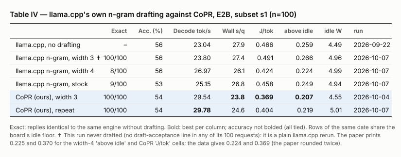

<details><summary>as text</summary>

|  | Exact | Acc. (%) | Decode tok/s | Wall s/q | J/tok | above idle | idle W | run |
|---|---:|---:|---:|---:|---:|---:|---:|---|
| llama.cpp, no drafting | – | 56 | 23.04 | 27.9 | 0.466 | 0.259 | 4.49 | 2026-09-22 |
| llama.cpp n-gram, width 3 ✝ | 100/100 | 56 | 23.80 | 27.4 | 0.491 | 0.266 | 4.96 | 2026-10-07 |
| llama.cpp n-gram, width 4 | 8/100 | 56 | 26.97 | 26.1 | 0.424 | 0.224 | 4.99 | 2026-10-07 |
| llama.cpp n-gram, stock | 9/100 | 53 | 25.15 | 26.8 | 0.458 | 0.249 | 4.94 | 2026-10-07 |
| CoPR (ours), width 3 | 100/100 | 54 | 29.54 | **23.8** | **0.369** | **0.207** | 4.55 | 2026-10-04 |
| CoPR (ours), repeat | 100/100 | 54 | **29.78** | 24.6 | 0.404 | 0.219 | 5.01 | 2026-10-07 |

Exact: replies identical to the same engine without drafting. Bold: best per column; accuracy not bolded (all tied). Rows of the same date share the board's idle floor. ✝ This run never drafted (no draft-acceptance line in any of its 100 requests): it is a plain llama.cpp rerun. The paper prints 0.225 and 0.370 for the width-4 'above idle' and CoPR 'J/tok' cells; the data gives 0.224 and 0.369 (the paper rounded twice).

</details>

### Table V — Ablation, n=300 per row; every row byte-identical to little-gemma

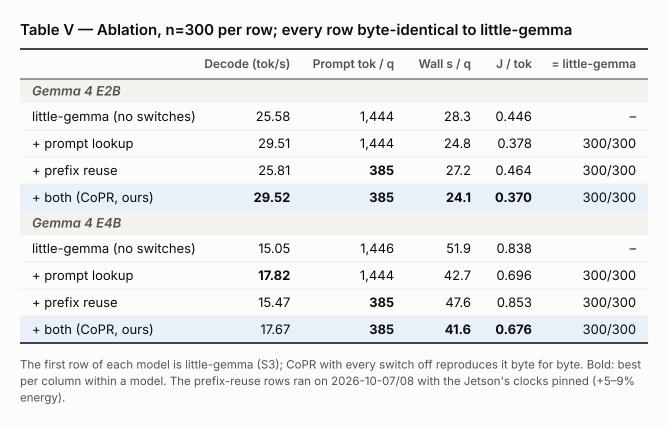

<details><summary>as text</summary>

|  | Decode (tok/s) | Prompt tok / q | Wall s / q | J / tok | = little-gemma |
|---|---:|---:|---:|---:|---:|
| *Gemma 4 E2B* | | | | | |
| little-gemma (no switches) | 25.58 | 1,444 | 28.3 | 0.446 | – |
| + prompt lookup | 29.51 | 1,444 | 24.8 | 0.378 | 300/300 |
| + prefix reuse | 25.81 | **385** | 27.2 | 0.464 | 300/300 |
| + both (CoPR, ours) | **29.52** | **385** | **24.1** | **0.370** | 300/300 |
| *Gemma 4 E4B* | | | | | |
| little-gemma (no switches) | 15.05 | 1,446 | 51.9 | 0.838 | – |
| + prompt lookup | **17.82** | 1,444 | 42.7 | 0.696 | 300/300 |
| + prefix reuse | 15.47 | **385** | 47.6 | 0.853 | 300/300 |
| + both (CoPR, ours) | 17.67 | **385** | **41.6** | **0.676** | 300/300 |

The first row of each model is little-gemma (S3); CoPR with every switch off reproduces it byte for byte. Bold: best per column within a model. The prefix-reuse rows ran on 2026-10-07/08 with the Jetson's clocks pinned (+5–9% energy).

</details>

### Table VI — Verify-width selection, 28 s1 questions per row

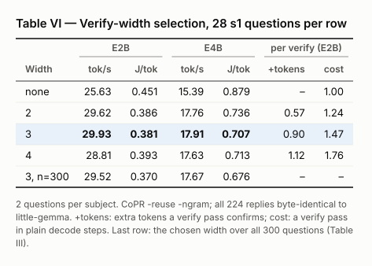

<details><summary>as text</summary>

| Width | E2B tok/s | E2B J/tok | E4B tok/s | E4B J/tok | per verify (E2B) +tokens | per verify (E2B) cost |
|---|---:|---:|---:|---:|---:|---:|
| none | 25.63 | 0.451 | 15.39 | 0.879 | – | 1.00 |
| 2 | 29.62 | 0.386 | 17.76 | 0.736 | 0.57 | 1.24 |
| 3 | **29.93** | **0.381** | **17.91** | **0.707** | 0.90 | 1.47 |
| 4 | 28.81 | 0.393 | 17.63 | 0.713 | 1.12 | 1.76 |
| 3, n=300 | 29.52 | 0.370 | 17.67 | 0.676 | – | – |

2 questions per subject. CoPR -reuse -ngram; all 224 replies byte-identical to little-gemma. +tokens: extra tokens a verify pass confirms; cost: a verify pass in plain decode steps. Last row: the chosen width over all 300 questions (Table III).

</details>

### Table VIII — Same checkpoint and 300 questions on other edge devices

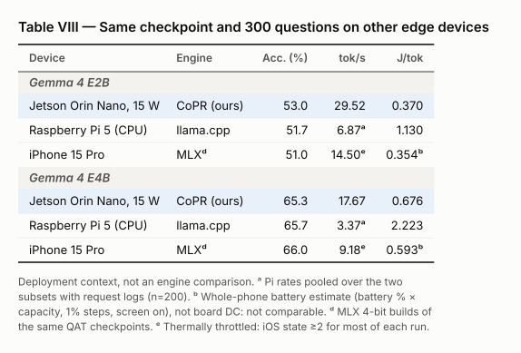

<details><summary>as text</summary>

| Device | Engine | Acc. (%) | tok/s | J/tok |
|---|---|---:|---:|---:|
| *Gemma 4 E2B* | | | | |
| Jetson Orin Nano, 15 W | CoPR (ours) | 53.0 | 29.52 | 0.370 |
| Raspberry Pi 5 (CPU) | llama.cpp | 51.7 | 6.87ᵃ | 1.130 |
| iPhone 15 Pro | MLXᵈ | 51.0 | 14.50ᵉ | 0.354ᵇ |
| *Gemma 4 E4B* | | | | |
| Jetson Orin Nano, 15 W | CoPR (ours) | 65.3 | 17.67 | 0.676 |
| Raspberry Pi 5 (CPU) | llama.cpp | 65.7 | 3.37ᵃ | 2.223 |
| iPhone 15 Pro | MLXᵈ | 66.0 | 9.18ᵉ | 0.593ᵇ |

Deployment context, not an engine comparison. ᵃ Pi rates pooled over the two subsets with request logs (n=200). ᵇ Whole-phone battery estimate (battery % × capacity, 1% steps, screen on), not board DC: not comparable. ᵈ MLX 4-bit builds of the same QAT checkpoints. ᵉ Thermally throttled: iOS state ≥2 for most of each run.

</details>

## 2. Which engines give the same replies

### Replies byte-identical between engines, Gemma 4 E2B (of 300)

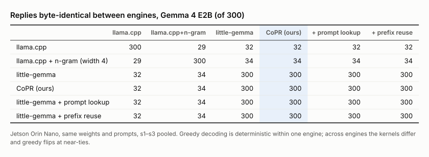

<details><summary>as text</summary>

|  | llama.cpp | llama.cpp+n-gram | little-gemma | CoPR (ours) | + prompt lookup | + prefix reuse |
|---|---:|---:|---:|---:|---:|---:|
| llama.cpp | 300 | 29 | 32 | 32 | 32 | 32 |
| llama.cpp + n-gram (width 4) | 29 | 300 | 34 | 34 | 34 | 34 |
| little-gemma | 32 | 34 | 300 | 300 | 300 | 300 |
| CoPR (ours) | 32 | 34 | 300 | 300 | 300 | 300 |
| little-gemma + prompt lookup | 32 | 34 | 300 | 300 | 300 | 300 |
| little-gemma + prefix reuse | 32 | 34 | 300 | 300 | 300 | 300 |

Jetson Orin Nano, same weights and prompts, s1–s3 pooled. Greedy decoding is deterministic within one engine; across engines the kernels differ and greedy flips at near-ties.

</details>

### Replies byte-identical between engines, Gemma 4 E4B (of 300)

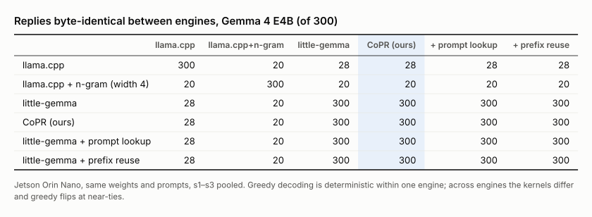

<details><summary>as text</summary>

|  | llama.cpp | llama.cpp+n-gram | little-gemma | CoPR (ours) | + prompt lookup | + prefix reuse |
|---|---:|---:|---:|---:|---:|---:|
| llama.cpp | 300 | 20 | 28 | 28 | 28 | 28 |
| llama.cpp + n-gram (width 4) | 20 | 300 | 20 | 20 | 20 | 20 |
| little-gemma | 28 | 20 | 300 | 300 | 300 | 300 |
| CoPR (ours) | 28 | 20 | 300 | 300 | 300 | 300 |
| little-gemma + prompt lookup | 28 | 20 | 300 | 300 | 300 | 300 |
| little-gemma + prefix reuse | 28 | 20 | 300 | 300 | 300 | 300 |

Jetson Orin Nano, same weights and prompts, s1–s3 pooled. Greedy decoding is deterministic within one engine; across engines the kernels differ and greedy flips at near-ties.

</details>

## 3. Accuracy

### MMLU-Pro accuracy by subset (%), every device

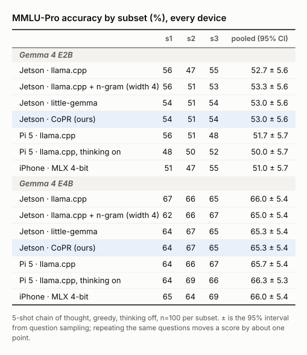

<details><summary>as text</summary>

|  | s1 | s2 | s3 | pooled (95% CI) |
|---|---:|---:|---:|---:|
| *Gemma 4 E2B* | | | | |
| Jetson · llama.cpp | 56 | 47 | 55 | 52.7 ± 5.6 |
| Jetson · llama.cpp + n-gram (width 4) | 56 | 51 | 53 | 53.3 ± 5.6 |
| Jetson · little-gemma | 54 | 51 | 54 | 53.0 ± 5.6 |
| Jetson · CoPR (ours) | 54 | 51 | 54 | 53.0 ± 5.6 |
| Pi 5 · llama.cpp | 56 | 51 | 48 | 51.7 ± 5.7 |
| iPhone · MLX 4-bit | 51 | 47 | 55 | 51.0 ± 5.7 |
| *Gemma 4 E4B* | | | | |
| Jetson · llama.cpp | 67 | 66 | 65 | 66.0 ± 5.4 |
| Jetson · llama.cpp + n-gram (width 4) | 62 | 66 | 67 | 65.0 ± 5.4 |
| Jetson · little-gemma | 64 | 67 | 65 | 65.3 ± 5.4 |
| Jetson · CoPR (ours) | 64 | 67 | 65 | 65.3 ± 5.4 |
| Pi 5 · llama.cpp | 64 | 66 | 67 | 65.7 ± 5.4 |
| iPhone · MLX 4-bit | 65 | 64 | 69 | 66.0 ± 5.4 |

5-shot chain of thought, greedy, thinking off, n=100 per subset. ± is the 95% interval from question sampling; repeating the same questions moves a score by about one point.

</details>

### Paired accuracy tests against llama.cpp (exact two-sided McNemar, n=300)

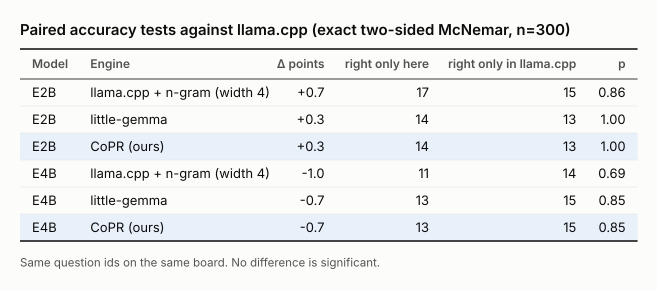

<details><summary>as text</summary>

| Model | Engine | Δ points | right only here | right only in llama.cpp | p |
|---|---|---:|---:|---:|---:|
| E2B | llama.cpp + n-gram (width 4) | +0.7 | 17 | 15 | 0.86 |
| E2B | little-gemma | +0.3 | 14 | 13 | 1.00 |
| E2B | CoPR (ours) | +0.3 | 14 | 13 | 1.00 |
| E4B | llama.cpp + n-gram (width 4) | -1.0 | 11 | 14 | 0.69 |
| E4B | little-gemma | -0.7 | 13 | 15 | 0.85 |
| E4B | CoPR (ours) | -0.7 | 13 | 15 | 0.85 |

Same question ids on the same board. No difference is significant.

</details>

### MMLU-Pro accuracy by subject, Gemma 4 E2B, Jetson, s1–s3 pooled

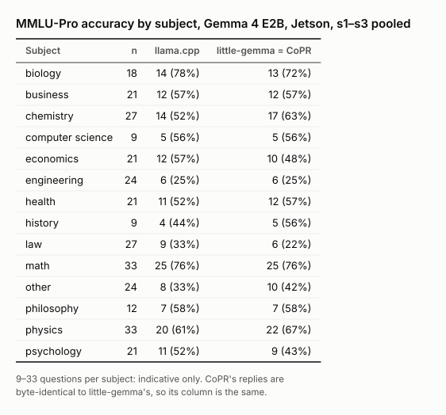

<details><summary>as text</summary>

| Subject | n | llama.cpp | little-gemma = CoPR |
|---|---:|---:|---:|
| biology | 18 | 14 (78%) | 13 (72%) |
| business | 21 | 12 (57%) | 12 (57%) |
| chemistry | 27 | 14 (52%) | 17 (63%) |
| computer science | 9 | 5 (56%) | 5 (56%) |
| economics | 21 | 12 (57%) | 10 (48%) |
| engineering | 24 | 6 (25%) | 6 (25%) |
| health | 21 | 11 (52%) | 12 (57%) |
| history | 9 | 4 (44%) | 5 (56%) |
| law | 27 | 9 (33%) | 6 (22%) |
| math | 33 | 25 (76%) | 25 (76%) |
| other | 24 | 8 (33%) | 10 (42%) |
| philosophy | 12 | 7 (58%) | 7 (58%) |
| physics | 33 | 20 (61%) | 22 (67%) |
| psychology | 21 | 11 (52%) | 9 (43%) |

9–33 questions per subject: indicative only. CoPR's replies are byte-identical to little-gemma's, so its column is the same.

</details>

### MMLU-Pro accuracy by subject, Gemma 4 E4B, Jetson, s1–s3 pooled


<details><summary>as text</summary>

| Subject | n | llama.cpp | little-gemma = CoPR |
|---|---:|---:|---:|
| biology | 18 | 13 (72%) | 12 (67%) |
| business | 21 | 15 (71%) | 15 (71%) |
| chemistry | 27 | 18 (67%) | 17 (63%) |
| computer science | 9 | 7 (78%) | 7 (78%) |
| economics | 21 | 15 (71%) | 13 (62%) |
| engineering | 24 | 10 (42%) | 12 (50%) |
| health | 21 | 13 (62%) | 14 (67%) |
| history | 9 | 7 (78%) | 7 (78%) |
| law | 27 | 11 (41%) | 10 (37%) |
| math | 33 | 28 (85%) | 27 (82%) |
| other | 24 | 14 (58%) | 14 (58%) |
| philosophy | 12 | 8 (67%) | 8 (67%) |
| physics | 33 | 26 (79%) | 27 (82%) |
| psychology | 21 | 13 (62%) | 13 (62%) |

9–33 questions per subject: indicative only. CoPR's replies are byte-identical to little-gemma's, so its column is the same.

</details>

## 4. Every Jetson run

### Every Jetson run in findings/runs/jetson/ (MMLU-Pro, one subset each)

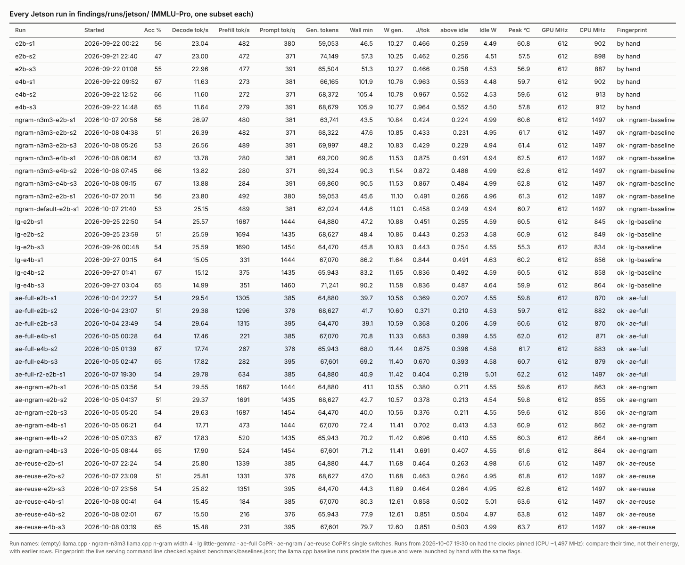

<details><summary>as text</summary>

| Run | Started | Acc % | Decode tok/s | Prefill tok/s | Prompt tok/q | Gen. tokens | Wall min | W gen. | J/tok | above idle | Idle W | Peak °C | GPU MHz | CPU MHz | Fingerprint |
|---|---|---:|---:|---:|---:|---:|---:|---:|---:|---:|---:|---:|---:|---:|---|
| e2b-s1 | 2026-09-22 00:22 | 56 | 23.04 | 482 | 380 | 59,053 | 46.5 | 10.27 | 0.466 | 0.259 | 4.49 | 60.8 | 612 | 902 | by hand |
| e2b-s2 | 2026-09-21 22:40 | 47 | 23.00 | 472 | 371 | 74,149 | 57.3 | 10.25 | 0.462 | 0.256 | 4.51 | 57.5 | 612 | 898 | by hand |
| e2b-s3 | 2026-09-22 01:08 | 55 | 22.96 | 477 | 391 | 65,504 | 51.3 | 10.27 | 0.466 | 0.258 | 4.53 | 56.9 | 612 | 887 | by hand |
| e4b-s1 | 2026-09-22 09:52 | 67 | 11.63 | 273 | 381 | 66,165 | 101.9 | 10.76 | 0.963 | 0.553 | 4.48 | 59.7 | 612 | 902 | by hand |
| e4b-s2 | 2026-09-22 12:52 | 66 | 11.60 | 272 | 371 | 68,372 | 105.4 | 10.78 | 0.967 | 0.552 | 4.53 | 59.6 | 612 | 913 | by hand |
| e4b-s3 | 2026-09-22 14:48 | 65 | 11.64 | 279 | 391 | 68,679 | 105.9 | 10.77 | 0.964 | 0.552 | 4.50 | 57.8 | 612 | 912 | by hand |
| ngram-n3m3-e2b-s1 | 2026-10-07 20:56 | 56 | 26.97 | 480 | 381 | 63,741 | 43.5 | 10.84 | 0.424 | 0.224 | 4.99 | 60.6 | 612 | 1497 | ok · ngram-baseline |
| ngram-n3m3-e2b-s2 | 2026-10-08 04:38 | 51 | 26.39 | 482 | 371 | 68,322 | 47.6 | 10.85 | 0.433 | 0.231 | 4.95 | 61.7 | 612 | 1497 | ok · ngram-baseline |
| ngram-n3m3-e2b-s3 | 2026-10-08 05:26 | 53 | 26.56 | 489 | 391 | 69,997 | 48.2 | 10.83 | 0.429 | 0.229 | 4.94 | 61.4 | 612 | 1497 | ok · ngram-baseline |
| ngram-n3m3-e4b-s1 | 2026-10-08 06:14 | 62 | 13.78 | 280 | 381 | 69,200 | 90.6 | 11.53 | 0.875 | 0.491 | 4.94 | 62.5 | 612 | 1497 | ok · ngram-baseline |
| ngram-n3m3-e4b-s2 | 2026-10-08 07:45 | 66 | 13.82 | 280 | 371 | 69,324 | 90.3 | 11.54 | 0.872 | 0.486 | 4.99 | 62.6 | 612 | 1497 | ok · ngram-baseline |
| ngram-n3m3-e4b-s3 | 2026-10-08 09:15 | 67 | 13.88 | 284 | 391 | 69,860 | 90.5 | 11.53 | 0.867 | 0.484 | 4.99 | 62.8 | 612 | 1497 | ok · ngram-baseline |
| ngram-n3m2-e2b-s1 | 2026-10-07 20:11 | 56 | 23.80 | 492 | 380 | 59,053 | 45.6 | 11.10 | 0.491 | 0.266 | 4.96 | 61.3 | 612 | 1497 | ok · ngram-baseline |
| ngram-default-e2b-s1 | 2026-10-07 21:40 | 53 | 25.15 | 489 | 381 | 62,024 | 44.6 | 11.01 | 0.458 | 0.249 | 4.94 | 60.7 | 612 | 1497 | ok · ngram-baseline |
| lg-e2b-s1 | 2026-09-25 22:50 | 54 | 25.57 | 1687 | 1444 | 64,880 | 47.2 | 10.88 | 0.451 | 0.255 | 4.59 | 60.5 | 612 | 845 | ok · lg-baseline |
| lg-e2b-s2 | 2026-09-25 23:59 | 51 | 25.59 | 1694 | 1435 | 68,627 | 48.4 | 10.86 | 0.443 | 0.253 | 4.58 | 60.9 | 612 | 849 | ok · lg-baseline |
| lg-e2b-s3 | 2026-09-26 00:48 | 54 | 25.59 | 1690 | 1454 | 64,470 | 45.8 | 10.83 | 0.443 | 0.254 | 4.55 | 55.3 | 612 | 834 | ok · lg-baseline |
| lg-e4b-s1 | 2026-09-27 00:15 | 64 | 15.05 | 331 | 1444 | 67,070 | 86.2 | 11.64 | 0.844 | 0.491 | 4.63 | 60.2 | 612 | 856 | ok · lg-baseline |
| lg-e4b-s2 | 2026-09-27 01:41 | 67 | 15.12 | 375 | 1435 | 65,943 | 83.2 | 11.65 | 0.836 | 0.492 | 4.59 | 60.5 | 612 | 858 | ok · lg-baseline |
| lg-e4b-s3 | 2026-09-27 03:04 | 65 | 14.99 | 351 | 1460 | 71,241 | 90.2 | 11.58 | 0.836 | 0.487 | 4.64 | 59.9 | 612 | 864 | ok · lg-baseline |
| ae-full-e2b-s1 | 2026-10-04 22:27 | 54 | 29.54 | 1305 | 385 | 64,880 | 39.7 | 10.56 | 0.369 | 0.207 | 4.55 | 59.8 | 612 | 870 | ok · ae-full |
| ae-full-e2b-s2 | 2026-10-04 23:07 | 51 | 29.38 | 1296 | 376 | 68,627 | 41.7 | 10.60 | 0.371 | 0.210 | 4.53 | 59.7 | 612 | 882 | ok · ae-full |
| ae-full-e2b-s3 | 2026-10-04 23:49 | 54 | 29.64 | 1315 | 395 | 64,470 | 39.1 | 10.59 | 0.368 | 0.206 | 4.59 | 60.6 | 612 | 870 | ok · ae-full |
| ae-full-e4b-s1 | 2026-10-05 00:28 | 64 | 17.46 | 221 | 385 | 67,070 | 70.8 | 11.33 | 0.683 | 0.399 | 4.55 | 62.0 | 612 | 871 | ok · ae-full |
| ae-full-e4b-s2 | 2026-10-05 01:39 | 67 | 17.74 | 267 | 376 | 65,943 | 68.0 | 11.44 | 0.675 | 0.396 | 4.58 | 61.7 | 612 | 883 | ok · ae-full |
| ae-full-e4b-s3 | 2026-10-05 02:47 | 65 | 17.82 | 282 | 395 | 67,601 | 69.2 | 11.40 | 0.670 | 0.393 | 4.58 | 60.7 | 612 | 879 | ok · ae-full |
| ae-full-r2-e2b-s1 | 2026-10-07 19:30 | 54 | 29.78 | 634 | 385 | 64,880 | 40.9 | 11.42 | 0.404 | 0.219 | 5.01 | 62.2 | 612 | 1497 | ok · ae-full |
| ae-ngram-e2b-s1 | 2026-10-05 03:56 | 54 | 29.55 | 1687 | 1444 | 64,880 | 41.1 | 10.55 | 0.380 | 0.211 | 4.55 | 59.6 | 612 | 863 | ok · ae-ngram |
| ae-ngram-e2b-s2 | 2026-10-05 04:37 | 51 | 29.37 | 1691 | 1435 | 68,627 | 42.7 | 10.57 | 0.378 | 0.213 | 4.54 | 59.8 | 612 | 855 | ok · ae-ngram |
| ae-ngram-e2b-s3 | 2026-10-05 05:20 | 54 | 29.63 | 1687 | 1454 | 64,470 | 40.0 | 10.56 | 0.376 | 0.211 | 4.55 | 59.6 | 612 | 856 | ok · ae-ngram |
| ae-ngram-e4b-s1 | 2026-10-05 06:21 | 64 | 17.71 | 473 | 1444 | 67,070 | 72.4 | 11.41 | 0.702 | 0.413 | 4.53 | 60.9 | 612 | 862 | ok · ae-ngram |
| ae-ngram-e4b-s2 | 2026-10-05 07:33 | 67 | 17.83 | 520 | 1435 | 65,943 | 70.2 | 11.42 | 0.696 | 0.410 | 4.55 | 60.3 | 612 | 864 | ok · ae-ngram |
| ae-ngram-e4b-s3 | 2026-10-05 08:44 | 65 | 17.90 | 524 | 1454 | 67,601 | 71.2 | 11.41 | 0.691 | 0.407 | 4.55 | 61.6 | 612 | 864 | ok · ae-ngram |
| ae-reuse-e2b-s1 | 2026-10-07 22:24 | 54 | 25.80 | 1339 | 385 | 64,880 | 44.7 | 11.68 | 0.464 | 0.263 | 4.98 | 61.6 | 612 | 1497 | ok · ae-reuse |
| ae-reuse-e2b-s2 | 2026-10-07 23:09 | 51 | 25.81 | 1331 | 376 | 68,627 | 47.0 | 11.68 | 0.463 | 0.264 | 4.95 | 61.8 | 612 | 1497 | ok · ae-reuse |
| ae-reuse-e2b-s3 | 2026-10-07 23:56 | 54 | 25.82 | 1351 | 395 | 64,470 | 44.3 | 11.69 | 0.464 | 0.264 | 4.95 | 62.6 | 612 | 1497 | ok · ae-reuse |
| ae-reuse-e4b-s1 | 2026-10-08 00:41 | 64 | 15.45 | 184 | 385 | 67,070 | 80.3 | 12.61 | 0.858 | 0.502 | 5.01 | 63.6 | 612 | 1497 | ok · ae-reuse |
| ae-reuse-e4b-s2 | 2026-10-08 02:01 | 67 | 15.50 | 216 | 376 | 65,943 | 77.9 | 12.61 | 0.851 | 0.504 | 4.97 | 63.8 | 612 | 1497 | ok · ae-reuse |
| ae-reuse-e4b-s3 | 2026-10-08 03:19 | 65 | 15.48 | 231 | 395 | 67,601 | 79.7 | 12.60 | 0.851 | 0.503 | 4.99 | 63.7 | 612 | 1497 | ok · ae-reuse |

Run names: (empty) llama.cpp · ngram-n3m3 llama.cpp n-gram width 4 · lg little-gemma · ae-full CoPR · ae-ngram / ae-reuse CoPR's single switches. Runs from 2026-10-07 19:30 on had the clocks pinned (CPU ~1,497 MHz): compare their time, not their energy, with earlier rows. Fingerprint: the live serving command line checked against benchmark/baselines.json; the llama.cpp baseline runs predate the queue and were launched by hand with the same flags.

</details>

### Failed runs (archived, rerun after the fix)

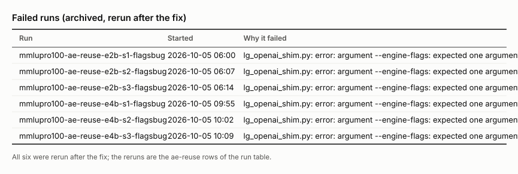

<details><summary>as text</summary>

| Run | Started | Why it failed |
|---|---|---|
| mmlupro100-ae-reuse-e2b-s1-flagsbug | 2026-10-05 06:00 | lg_openai_shim.py: error: argument --engine-flags: expected one argument |
| mmlupro100-ae-reuse-e2b-s2-flagsbug | 2026-10-05 06:07 | lg_openai_shim.py: error: argument --engine-flags: expected one argument |
| mmlupro100-ae-reuse-e2b-s3-flagsbug | 2026-10-05 06:14 | lg_openai_shim.py: error: argument --engine-flags: expected one argument |
| mmlupro100-ae-reuse-e4b-s1-flagsbug | 2026-10-05 09:55 | lg_openai_shim.py: error: argument --engine-flags: expected one argument |
| mmlupro100-ae-reuse-e4b-s2-flagsbug | 2026-10-05 10:02 | lg_openai_shim.py: error: argument --engine-flags: expected one argument |
| mmlupro100-ae-reuse-e4b-s3-flagsbug | 2026-10-05 10:09 | lg_openai_shim.py: error: argument --engine-flags: expected one argument |

All six were rerun after the fix; the reruns are the ae-reuse rows of the run table.

</details>

## 5. Pi 5 and iPhone, run by run

### Raspberry Pi 5, llama.cpp 661643e (CPU): every MMLU-Pro baseline run

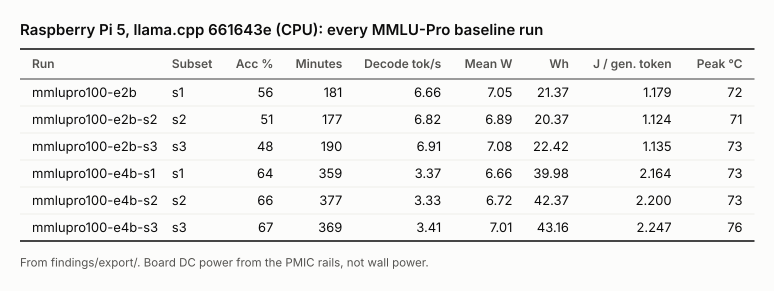

<details><summary>as text</summary>

| Run | Subset | Acc % | Minutes | Decode tok/s | Mean W | Wh | J / gen. token | Peak °C |
|---|---|---:|---:|---:|---:|---:|---:|---:|
| mmlupro100-e2b | s1 | 56 | 181 | 6.66 | 7.05 | 21.37 | 1.179 | 72 |
| mmlupro100-e2b-s2 | s2 | 51 | 177 | 6.82 | 6.89 | 20.37 | 1.124 | 71 |
| mmlupro100-e2b-s3 | s3 | 48 | 190 | 6.91 | 7.08 | 22.42 | 1.135 | 73 |
| mmlupro100-e4b-s1 | s1 | 64 | 359 | 3.37 | 6.66 | 39.98 | 2.164 | 73 |
| mmlupro100-e4b-s2 | s2 | 66 | 377 | 3.33 | 6.72 | 42.37 | 2.200 | 73 |
| mmlupro100-e4b-s3 | s3 | 67 | 369 | 3.41 | 7.01 | 43.16 | 2.247 | 76 |

From findings/export/. Board DC power from the PMIC rails, not wall power.

</details>

### iPhone 15 Pro, MLX: every upload

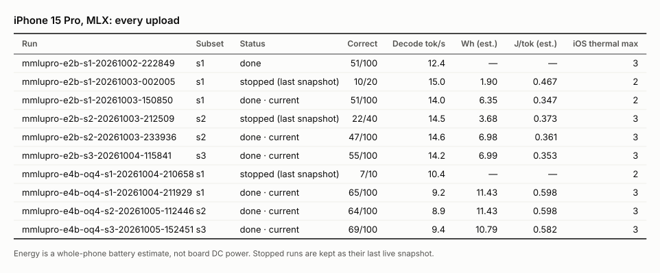

<details><summary>as text</summary>

| Run | Subset | Status | Correct | Decode tok/s | Wh (est.) | J/tok (est.) | iOS thermal max |
|---|---|---|---:|---:|---:|---:|---:|
| mmlupro-e2b-s1-20261002-222849 | s1 | done | 51/100 | 12.4 | — | — | 3 |
| mmlupro-e2b-s1-20261003-002005 | s1 | stopped (last snapshot) | 10/20 | 15.0 | 1.90 | 0.467 | 2 |
| mmlupro-e2b-s1-20261003-150850 | s1 | done · current | 51/100 | 14.0 | 6.35 | 0.347 | 2 |
| mmlupro-e2b-s2-20261003-212509 | s2 | stopped (last snapshot) | 22/40 | 14.5 | 3.68 | 0.373 | 3 |
| mmlupro-e2b-s2-20261003-233936 | s2 | done · current | 47/100 | 14.6 | 6.98 | 0.361 | 3 |
| mmlupro-e2b-s3-20261004-115841 | s3 | done · current | 55/100 | 14.2 | 6.99 | 0.353 | 3 |
| mmlupro-e4b-oq4-s1-20261004-210658 | s1 | stopped (last snapshot) | 7/10 | 10.4 | — | — | 2 |
| mmlupro-e4b-oq4-s1-20261004-211929 | s1 | done · current | 65/100 | 9.2 | 11.43 | 0.598 | 3 |
| mmlupro-e4b-oq4-s2-20261005-112446 | s2 | done · current | 64/100 | 8.9 | 11.43 | 0.598 | 3 |
| mmlupro-e4b-oq4-s3-20261005-152451 | s3 | done · current | 69/100 | 9.4 | 10.79 | 0.582 | 3 |

Energy is a whole-phone battery estimate, not board DC power. Stopped runs are kept as their last live snapshot.

</details>

## 6. tinyGSM8k

### tinyGSM8k on the Raspberry Pi 5 (llama.cpp), IRT-estimated GSM8K accuracy (%)

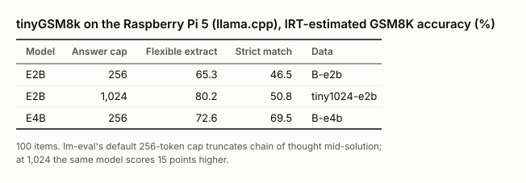

<details><summary>as text</summary>

| Model | Answer cap | Flexible extract | Strict match | Data |
|---|---:|---:|---:|---|
| E2B | 256 | 65.3 | 46.5 | B-e2b |
| E2B | 1,024 | 80.2 | 50.8 | tiny1024-e2b |
| E4B | 256 | 72.6 | 69.5 | B-e4b |

100 items. lm-eval's default 256-token cap truncates chain of thought mid-solution; at 1,024 the same model scores 15 points higher.

</details>

## 7. Own suite (Pi 5, not in the manuscript)

The 10-case suite against five architectures, MTP × thinking and an E4B quantisation sweep, from `benchmark/results/*.json` via `benchmark/report.py` (text only). Write-up: `RESULTS.md` §2–§4.

### T1 — Architecture comparison

Tool-selection and fabrication are over the tool-requiring cases; static accuracy over the fixed-ground-truth cases. Latency is warm median, cold shown separately.

| device | cond | architecture | model | tool sel. | fabrication | static acc | TTFT (warm) | total (warm) | total (cold) |
|---|---|---|---|---|---|---|---|---|---|
| raspi5 | A-cpu | little-gemma (bare) [CPU] | gemma4-e2b | 0.0% (0/12) | 0.0% (0/12) | 100.0% (4/4) | 11.79 | 43.529 | 43.651 |
| raspi5 | A-cpu | little-gemma (bare) [CPU] | gemma4-e4b | 0.0% (0/12) | 0.0% (0/12) | 100.0% (4/4) | 24.75 | 92.51 | 92.524 |
| raspi5 | B | llama.cpp (bare) | gemma4-e2b | 0.0% (0/24) | 0.0% (0/24) | 100.0% (8/8) | 0.221 | 6.445 | 6.625 |
| raspi5 | B | llama.cpp (bare) | gemma4-e2b | 0.0% (0/8) | 0.0% (0/8) | 100.0% (8/8) | 0.22 | 3.596 | 3.774 |
| raspi5 | B | llama.cpp (bare) | gemma4-e4b | 0.0% (0/4) | 0.0% (0/4) | 50.0% (4/8) | 0.645 | 5.565 | 7.479 |
| raspi5 | B | llama.cpp (bare) | gemma4-e4b | 0.0% (0/24) | 0.0% (0/24) | 100.0% (8/8) | 0.462 | 12.434 | 12.815 |
| raspi5 | B | llama.cpp (bare) | gemma4-e4b | 0.0% (0/8) | 0.0% (0/8) | 100.0% (8/8) | 0.473 | 8.303 | 8.921 |
| raspi5 | B | llama.cpp (bare) | gemma4-e4b | 0.0% (0/4) | 0.0% (0/4) | 100.0% (8/8) | 0.44 | 5.19 | 5.967 |
| raspi5 | B | llama.cpp (bare) | gemma4-e4b | 0.0% (0/4) | 0.0% (0/4) | 100.0% (8/8) | 0.738 | 8.864 | 11.104 |
| raspi5 | B | llama.cpp (bare) | gemma4-e4b | 0.0% (0/4) | 0.0% (0/4) | 87.5% (7/8) | 0.924 | 12.622 | 15.246 |
| raspi5 | B-mtp | llama.cpp (bare) [MTP] | gemma4-e2b | 0.0% (0/8) | 0.0% (0/8) | 100.0% (8/8) | 0.221 | 2.331 | 2.508 |
| raspi5 | B-mtp | llama.cpp (bare) [MTP] | gemma4-e4b | 0.0% (0/8) | 0.0% (0/8) | 100.0% (8/8) | 0.428 | 4.912 | 5.481 |
| raspi5 | B-mtp-think | llama.cpp (bare) [MTP, thinking] | gemma4-e2b | 0.0% (0/8) | 0.0% (0/8) | 100.0% (8/8) | 11.615 | 13.682 | 14.006 |
| raspi5 | B-mtp-think | llama.cpp (bare) [MTP, thinking] | gemma4-e4b | 0.0% (0/8) | 0.0% (0/8) | 100.0% (8/8) | 20.518 | 29.399 | 29.097 |
| raspi5 | B-think | llama.cpp (bare) [thinking] | gemma4-e2b | 0.0% (0/8) | 0.0% (0/8) | 100.0% (8/8) | 23.802 | 28.283 | 28.552 |
| raspi5 | B-think | llama.cpp (bare) [thinking] | gemma4-e4b | 0.0% (0/8) | 0.0% (0/8) | 100.0% (8/8) | 44.347 | 63.176 | 63.637 |
| raspi5 | C | LiteRT-LM (bare) | gemma4-e2b | skipped: model — E2B is NOT imported on this box, so condition C is E4B-only. Serve with: /home/mitlab/litert-venv/bin/litert-lm serve --host 127.0.0.1 --port 9379 (no model argument; the request's model id picks the bundle) | — | — | — | — | — |
| raspi5 | C | LiteRT-LM (bare) | gemma4-e4b | 0.0% (0/24) | 0.0% (0/24) | 50.0% (4/8) | 4.287 | 17.511 | 18.648 |
| raspi5 | D | llama.cpp + naive function calling | gemma4-e2b | 100.0% (24/24) | 0.0% (0/24) | 50.0% (4/8) | 0.142 | 2.54 | 3.018 |
| raspi5 | D | llama.cpp + naive function calling | gemma4-e4b | 100.0% (24/24) | 0.0% (0/24) | 100.0% (8/8) | 0.272 | 5.05 | 6.03 |
| raspi5 | E | proposed orchestrator | gemma4-e2b | 83.3% (20/24) | 0.0% (0/24) | 50.0% (4/8) | 24.195 | 26.16 | 33.575 |
| raspi5 | E | proposed orchestrator | gemma4-e2b | 100.0% (8/8) | 0.0% (0/8) | 50.0% (4/8) | 29.51 | 29.51 | 37.24 |
| raspi5 | E | proposed orchestrator | gemma4-e4b | 100.0% (24/24) | 0.0% (0/24) | 87.5% (7/8) | 57.785 | 60.235 | 66.395 |
| raspi5 | E | proposed orchestrator | gemma4-e4b | 100.0% (8/8) | 0.0% (0/8) | 87.5% (7/8) | 54.17 | 54.17 | 66.61 |
| raspi5 | E-mtp | proposed orchestrator [MTP] | gemma4-e2b | 100.0% (8/8) | 0.0% (0/8) | 50.0% (4/8) | 23.68 | 23.68 | 37.05 |
| raspi5 | E-mtp | proposed orchestrator [MTP] | gemma4-e4b | 100.0% (8/8) | 0.0% (0/8) | 100.0% (8/8) | 40.68 | 40.68 | 64.42 |
| raspi5 | E-mtp-think | proposed orchestrator [MTP, thinking] | gemma4-e2b | 100.0% (8/8) | 0.0% (0/8) | 100.0% (8/8) | 45.07 | 51.05 | 52.96 |
| raspi5 | E-mtp-think | proposed orchestrator [MTP, thinking] | gemma4-e4b | 100.0% (8/8) | 0.0% (0/8) | 100.0% (8/8) | 88.02 | 94.1 | 94.86 |
| raspi5 | E-think | proposed orchestrator [thinking] | gemma4-e2b | 100.0% (8/8) | 0.0% (0/8) | 100.0% (8/8) | 51.46 | 59.36 | 72.33 |
| raspi5 | E-think | proposed orchestrator [thinking] | gemma4-e4b | 100.0% (8/8) | 0.0% (0/8) | 100.0% (8/8) | 107.34 | 109.32 | 128.67 |

### T2 — MTP x thinking x CUDA

Only engines that support the toggles appear. `model time` excludes tool network I/O, which is not the architecture's cost.

| device | cuda | cond | model | mtp | TTFT | total | model time | tok/s | static acc |
|---|---|---|---|---|---|---|---|---|---|
| raspi5 | no | B | gemma4-e2b | off | 0.221 | 6.445 | — | — | 100.0% (8/8) |
| raspi5 | no | B | gemma4-e2b | off | 0.22 | 3.596 | — | — | 100.0% (8/8) |
| raspi5 | no | B | gemma4-e4b | off | 0.645 | 5.565 | — | — | 50.0% (4/8) |
| raspi5 | no | B | gemma4-e4b | off | 0.462 | 12.434 | — | — | 100.0% (8/8) |
| raspi5 | no | B | gemma4-e4b | off | 0.473 | 8.303 | — | — | 100.0% (8/8) |
| raspi5 | no | B | gemma4-e4b | off | 0.44 | 5.19 | — | — | 100.0% (8/8) |
| raspi5 | no | B | gemma4-e4b | off | 0.738 | 8.864 | — | — | 100.0% (8/8) |
| raspi5 | no | B | gemma4-e4b | off | 0.924 | 12.622 | — | — | 87.5% (7/8) |
| raspi5 | no | B-mtp | gemma4-e2b | on | 0.221 | 2.331 | — | — | 100.0% (8/8) |
| raspi5 | no | B-mtp | gemma4-e4b | on | 0.428 | 4.912 | — | — | 100.0% (8/8) |
| raspi5 | no | B-mtp-think | gemma4-e2b | on | 11.615 | 13.682 | — | — | 100.0% (8/8) |
| raspi5 | no | B-mtp-think | gemma4-e4b | on | 20.518 | 29.399 | — | — | 100.0% (8/8) |
| raspi5 | no | B-think | gemma4-e2b | off | 23.802 | 28.283 | — | — | 100.0% (8/8) |
| raspi5 | no | B-think | gemma4-e4b | off | 44.347 | 63.176 | — | — | 100.0% (8/8) |
| raspi5 | no | E | gemma4-e2b | off | 24.195 | 26.16 | 25.775 | — | 50.0% (4/8) |
| raspi5 | no | E | gemma4-e2b | off | 29.51 | 29.51 | 29.51 | — | 50.0% (4/8) |
| raspi5 | no | E | gemma4-e4b | off | 57.785 | 60.235 | 60.055 | — | 87.5% (7/8) |
| raspi5 | no | E | gemma4-e4b | off | 54.17 | 54.17 | 54.17 | — | 87.5% (7/8) |
| raspi5 | no | E-mtp | gemma4-e2b | on | 23.68 | 23.68 | 23.68 | — | 50.0% (4/8) |
| raspi5 | no | E-mtp | gemma4-e4b | on | 40.68 | 40.68 | 40.68 | — | 100.0% (8/8) |
| raspi5 | no | E-mtp-think | gemma4-e2b | on | 45.07 | 51.05 | 49.04 | — | 100.0% (8/8) |
| raspi5 | no | E-mtp-think | gemma4-e4b | on | 88.02 | 94.1 | 92.54 | — | 100.0% (8/8) |
| raspi5 | no | E-think | gemma4-e2b | off | 51.46 | 59.36 | 57.12 | — | 100.0% (8/8) |
| raspi5 | no | E-think | gemma4-e4b | off | 107.34 | 109.32 | 108.77 | — | 100.0% (8/8) |

### T3 — Quantization sweep

| device | cond | model | quant | tok/s | TTFT | total | static acc | tool sel. |
|---|---|---|---|---|---|---|---|---|
| raspi5 | B | gemma4-e4b | Q4_K_M | — | 0.645 | 5.565 | 50.0% (4/8) | 0.0% (0/4) |
| raspi5 | A-cpu | gemma4-e2b | Q4_K_XL | 1.5 | 11.79 | 43.529 | 100.0% (4/4) | 0.0% (0/12) |
| raspi5 | B | gemma4-e2b | Q4_K_XL | — | 0.221 | 6.445 | 100.0% (8/8) | 0.0% (0/24) |
| raspi5 | D | gemma4-e2b | Q4_K_XL | — | 0.142 | 2.54 | 50.0% (4/8) | 100.0% (24/24) |
| raspi5 | E | gemma4-e2b | Q4_K_XL | — | 24.195 | 26.16 | 50.0% (4/8) | 83.3% (20/24) |
| raspi5 | A-cpu | gemma4-e4b | Q4_K_XL | 0.7 | 24.75 | 92.51 | 100.0% (4/4) | 0.0% (0/12) |
| raspi5 | B | gemma4-e4b | Q4_K_XL | — | 0.462 | 12.434 | 100.0% (8/8) | 0.0% (0/24) |
| raspi5 | D | gemma4-e4b | Q4_K_XL | — | 0.272 | 5.05 | 100.0% (8/8) | 100.0% (24/24) |
| raspi5 | E | gemma4-e4b | Q4_K_XL | — | 57.785 | 60.235 | 87.5% (7/8) | 100.0% (24/24) |
| raspi5 | B | gemma4-e2b | Q4_K_XL | — | 0.22 | 3.596 | 100.0% (8/8) | 0.0% (0/8) |
| raspi5 | B-mtp | gemma4-e2b | Q4_K_XL | — | 0.221 | 2.331 | 100.0% (8/8) | 0.0% (0/8) |
| raspi5 | B-think | gemma4-e2b | Q4_K_XL | — | 23.802 | 28.283 | 100.0% (8/8) | 0.0% (0/8) |
| raspi5 | B-mtp-think | gemma4-e2b | Q4_K_XL | — | 11.615 | 13.682 | 100.0% (8/8) | 0.0% (0/8) |
| raspi5 | E | gemma4-e2b | Q4_K_XL | — | 29.51 | 29.51 | 50.0% (4/8) | 100.0% (8/8) |
| raspi5 | E-mtp | gemma4-e2b | Q4_K_XL | — | 23.68 | 23.68 | 50.0% (4/8) | 100.0% (8/8) |
| raspi5 | E-think | gemma4-e2b | Q4_K_XL | — | 51.46 | 59.36 | 100.0% (8/8) | 100.0% (8/8) |
| raspi5 | E-mtp-think | gemma4-e2b | Q4_K_XL | — | 45.07 | 51.05 | 100.0% (8/8) | 100.0% (8/8) |
| raspi5 | B | gemma4-e4b | Q4_K_XL | — | 0.473 | 8.303 | 100.0% (8/8) | 0.0% (0/8) |
| raspi5 | B-mtp | gemma4-e4b | Q4_K_XL | — | 0.428 | 4.912 | 100.0% (8/8) | 0.0% (0/8) |
| raspi5 | B-think | gemma4-e4b | Q4_K_XL | — | 44.347 | 63.176 | 100.0% (8/8) | 0.0% (0/8) |
| raspi5 | B-mtp-think | gemma4-e4b | Q4_K_XL | — | 20.518 | 29.399 | 100.0% (8/8) | 0.0% (0/8) |
| raspi5 | E | gemma4-e4b | Q4_K_XL | — | 54.17 | 54.17 | 87.5% (7/8) | 100.0% (8/8) |
| raspi5 | E-mtp | gemma4-e4b | Q4_K_XL | — | 40.68 | 40.68 | 100.0% (8/8) | 100.0% (8/8) |
| raspi5 | E-think | gemma4-e4b | Q4_K_XL | — | 107.34 | 109.32 | 100.0% (8/8) | 100.0% (8/8) |
| raspi5 | E-mtp-think | gemma4-e4b | Q4_K_XL | — | 88.02 | 94.1 | 100.0% (8/8) | 100.0% (8/8) |
| raspi5 | B | gemma4-e4b | Q4_K_XL | — | 0.44 | 5.19 | 100.0% (8/8) | 0.0% (0/4) |
| raspi5 | C | gemma4-e4b | Q4_K_XL | — | 4.287 | 17.511 | 50.0% (4/8) | 0.0% (0/24) |
| raspi5 | B | gemma4-e4b | Q5_K_M | — | 0.738 | 8.864 | 100.0% (8/8) | 0.0% (0/4) |
| raspi5 | B | gemma4-e4b | Q8_0 | — | 0.924 | 12.622 | 87.5% (7/8) | 0.0% (0/4) |

_File size on disk and resident RSS are not captured automatically — record them by hand for this table._

### T4 — Classifier behaviour (condition E only)

`creative` calling no tool is a positive result: the classifier does not over-trigger. Per-category latency shows the tool tax is paid only where it is needed.

**raspi5 / E / gemma4-e2b Q4_K_XL**

| category | n | tool(s) called | tool correct | fabricated | total (warm med) |
|---|---|---|---|---|---|
| creative | 4 | none | n/a | 0 | 5.31 |
| currency | 4 | none | 0/4 | 0 | 2.89 |
| fixture | 4 | match_result | 4/4 | 0 | 37.39 |
| knowledge | 8 | none | n/a | 0 | 8.9 |
| match_result | 4 | match_result | 4/4 | 0 | 40.17 |
| news | 4 | web_search | 4/4 | 0 | 22.12 |
| race_result | 4 | f1_result | 4/4 | 0 | 36.89 |
| thinking | 4 | none | n/a | 0 | 29.07 |
| weather | 4 | weather_forecast | 4/4 | 0 | 40.26 |

**raspi5 / E / gemma4-e2b Q4_K_XL**

| category | n | tool(s) called | tool correct | fabricated | total (warm med) |
|---|---|---|---|---|---|
| creative | 4 | none | n/a | 0 | 5.36 |
| knowledge | 4 | none | n/a | 0 | 0.45 |
| match_result | 4 | match_result | 4/4 | 0 | 40.28 |
| thinking | 4 | none | n/a | 0 | 29.51 |
| weather | 4 | weather_forecast | 4/4 | 0 | 40.51 |

**raspi5 / E / gemma4-e4b Q4_K_XL**

| category | n | tool(s) called | tool correct | fabricated | total (warm med) |
|---|---|---|---|---|---|
| creative | 4 | none | n/a | 0 | 11.33 |
| currency | 4 | currency_rate | 4/4 | 0 | 68.15 |
| fixture | 4 | match_result | 4/4 | 0 | 65.54 |
| knowledge | 8 | none | n/a | 0 | 17.92 |
| match_result | 4 | match_result | 4/4 | 0 | 72.35 |
| news | 4 | web_search | 4/4 | 0 | 47.01 |
| race_result | 4 | f1_result | 4/4 | 0 | 66.94 |
| thinking | 4 | none | n/a | 0 | 54.82 |
| weather | 4 | weather_forecast | 4/4 | 0 | 69.86 |

**raspi5 / E / gemma4-e4b Q4_K_XL**

| category | n | tool(s) called | tool correct | fabricated | total (warm med) |
|---|---|---|---|---|---|
| creative | 4 | none | n/a | 0 | 11.09 |
| knowledge | 4 | none | n/a | 0 | 0.75 |
| match_result | 4 | match_result | 4/4 | 0 | 72.35 |
| thinking | 4 | none | n/a | 0 | 54.17 |
| weather | 4 | weather_forecast | 4/4 | 0 | 70.03 |

**raspi5 / E-mtp / gemma4-e2b Q4_K_XL**

| category | n | tool(s) called | tool correct | fabricated | total (warm med) |
|---|---|---|---|---|---|
| creative | 4 | none | n/a | 0 | 4.68 |
| knowledge | 4 | none | n/a | 0 | 0.53 |
| match_result | 4 | match_result | 4/4 | 0 | 39.36 |
| thinking | 4 | none | n/a | 0 | 23.68 |
| weather | 4 | weather_forecast | 4/4 | 0 | 39.54 |

**raspi5 / E-mtp / gemma4-e4b Q4_K_XL**

| category | n | tool(s) called | tool correct | fabricated | total (warm med) |
|---|---|---|---|---|---|
| creative | 4 | none | n/a | 0 | 9.25 |
| knowledge | 4 | none | n/a | 0 | 0.87 |
| match_result | 4 | match_result | 4/4 | 0 | 67.16 |
| thinking | 4 | none | n/a | 0 | 40.68 |
| weather | 4 | weather_forecast | 4/4 | 0 | 64.46 |

**raspi5 / E-mtp-think / gemma4-e2b Q4_K_XL**

| category | n | tool(s) called | tool correct | fabricated | total (warm med) |
|---|---|---|---|---|---|
| creative | 4 | none | n/a | 0 | 33.94 |
| knowledge | 4 | web_search | n/a | 0 | 30.06 |
| match_result | 4 | match_result | 4/4 | 0 | 52.88 |
| thinking | 4 | none | n/a | 0 | 56.15 |
| weather | 4 | weather_forecast | 4/4 | 0 | 51.05 |

**raspi5 / E-mtp-think / gemma4-e4b Q4_K_XL**

| category | n | tool(s) called | tool correct | fabricated | total (warm med) |
|---|---|---|---|---|---|
| creative | 4 | none | n/a | 0 | 58.52 |
| knowledge | 4 | none | n/a | 0 | 53.69 |
| match_result | 4 | match_result | 4/4 | 0 | 94.1 |
| thinking | 4 | none | n/a | 0 | 134.64 |
| weather | 4 | weather_forecast | 4/4 | 0 | 94.57 |

**raspi5 / E-think / gemma4-e2b Q4_K_XL**

| category | n | tool(s) called | tool correct | fabricated | total (warm med) |
|---|---|---|---|---|---|
| creative | 4 | none | n/a | 0 | 45.17 |
| knowledge | 4 | web_search | n/a | 0 | 33.29 |
| match_result | 4 | match_result | 4/4 | 0 | 72.25 |
| thinking | 4 | none | n/a | 0 | 101.7 |
| weather | 4 | weather_forecast | 4/4 | 0 | 59.36 |

**raspi5 / E-think / gemma4-e4b Q4_K_XL**

| category | n | tool(s) called | tool correct | fabricated | total (warm med) |
|---|---|---|---|---|---|
| creative | 4 | none | n/a | 0 | 90.38 |
| knowledge | 4 | web_search | n/a | 0 | 80.23 |
| match_result | 4 | match_result | 4/4 | 0 | 109.32 |
| thinking | 4 | none | n/a | 0 | 188.33 |
| weather | 4 | weather_forecast | 4/4 | 0 | 128.81 |

## 8. Where the data and the manuscript disagree

From `paper_tables.py --table issues`:

```
1. Table IV's 'llama.cpp n-gram, width 3' row (n3m2) never drafted.
   Requests whose llama-server log has a draft-acceptance line:
     mmlupro100-ngram-n3m2-e2b-s1           0/100
     mmlupro100-ngram-n3m3-e2b-s1         100/100
     mmlupro100-ngram-default-e2b-s1       94/100
   So its 100/100 'exact' is plain decoding and its +3% is day-to-day spread;
   it says nothing about whether width-3 drafting in llama.cpp is exact.
2. Runs from 2026-10-07 19:30 on had the Jetson's clocks pinned (jetson_clocks,
   RESULTS 7.7): CPU at its 1,497.6 MHz cap instead of scaling. The paper puts the
   cross-day energy band down to idle floor and temperature without naming it.
     run                                  started            CPU MHz idle W
     mmlupro100-e2b-s1                    20260922-002204        902   4.49
     mmlupro100-ae-full-e2b-s1            20261004-222749        870   4.55
     mmlupro100-ae-full-r2-e2b-s1         20261007-193003       1497   5.01
     mmlupro100-ae-reuse-e2b-s1           20261007-222454       1497   4.98
     mmlupro100-ngram-n3m3-e2b-s1         20261007-205641       1497   4.99
     mmlupro100-ngram-n3m2-e2b-s1         20261007-201101       1497   4.96
```
